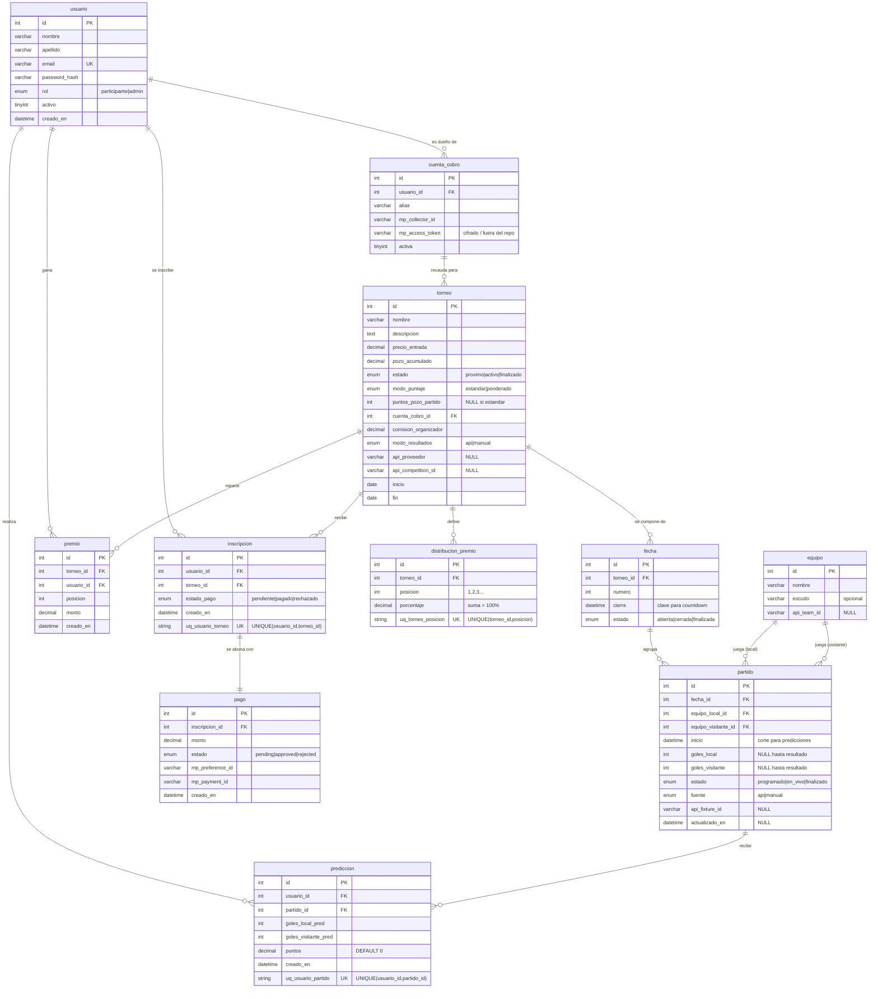

# DER — Prode de Torneos de Fútbol

Diagrama Entidad-Relación del modelo de datos (11 entidades).
Render: GitHub, VS Code (Markdown Preview Mermaid) o https://mermaid.live (exporta PNG/SVG).

> El **ranking** no es una tabla: se calcula con `SUM(prediccion.puntos) GROUP BY usuario` por torneo.



## Lectura rápida de la columna vertebral

```
torneo (1)──< fecha (1)──< partido (1)──< prediccion >──(1) usuario
```

Un torneo tiene varias fechas, cada fecha varios partidos, cada partido una predicción por
participante. Sobre esa espina dorsal se apoyan:

- **Inscripción/pago:** `usuario ──< inscripcion >── torneo`, y cada `inscripcion ──── pago` (1:1).
- **Recaudación:** `cuenta_cobro ──< torneo` (la cuenta de MP donde recauda el organizador).
- **Premiación:** `torneo ──< distribucion_premio` (reglas: qué % por puesto) y
  `torneo ──< premio >── usuario` (montos ya repartidos al finalizar).

## Notas de cardinalidad

| Relación | Tipo | Nota |
|---|---|---|
| usuario – torneo | N:M | resuelta por `inscripcion` |
| inscripcion – pago | 1:1 | a lo sumo un pago aprobado por inscripción |
| equipo – partido | 1:N (×2) | un equipo juega como local **y** como visitante |
| torneo – distribucion_premio | 1:N | un % por puesto; la suma debe dar 100% |
```
